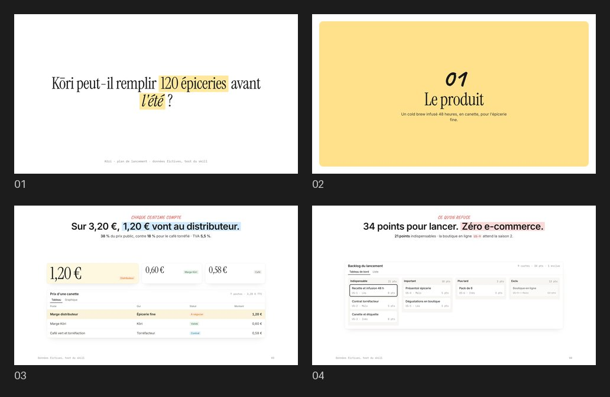

# Présentations agence

Un skill Claude qui fabrique des présentations de niveau agence, dans 10 styles tirés d'univers visuels réels, sans le look « généré par IA ».

Le principe : chaque deck emprunte les codes d'un objet qui existe vraiment (un ticket de caisse, une une de journal, une affiche sérigraphiée, un rapport annuel suisse). Le format raconte le concept avant même que le texte soit lu. C'est l'inverse d'un template, qui part d'une grille vide et la remplit.

## Les 10 styles

| Style | Univers réel | Pour |
| --- | --- | --- |
| Éditorial objet réel | Magazine + objets du sujet (ticket, menu, billet) | Pitchs de marque, lancements |
| Studio sombre | Photo de produit en studio, objet 3D en three.js | Soutenances, investisseurs, données |
| Rapport suisse | Rapports annuels suisses, style typographique international | Bilans, finance, gouvernance |
| Une de journal | Presse quotidienne, éditions spéciales | Annonces, institutions, grand public |
| Affiche sérigraphie | Affiches de concert, risographie, caractères en bois | Événements, culture, associations |
| Magazine de mode | Couvertures et éditoriaux de magazines | Mode, beauté, marques à forte image |
| Data-journalisme | Enquêtes graphiques de la presse | Études, mémoires, analyses chiffrées |
| Brutalisme web | Premiers sites web, docs techniques, terminaux | Produits tech, publics développeurs |
| Espace de travail | Outils de travail en équipe (type Notion) : bases de données, kanban, surligneurs | Gestion de projet, plans de lancement, soutenances en équipe |
| Heure bleue | Un lieu en 3D au crépuscule derrière tout le deck, qui se construit au fil du récit | Pitchs longs autour d'un lieu : immobilier, ville, magasin, usine |

Chaque style a sa fiche dans [`presentations-agence/references/`](presentations-agence/references) : palette avec le rôle de chaque couleur, polices Google Fonts, éléments signature, traitement des images, 12 à 16 layouts, ton, interdits et check avant de livrer. Neuf styles ont aussi des gabarits validés dans [`presentations-agence/gabarits/`](presentations-agence/gabarits) (34 en tout) ; Heure bleue, qui demande un monde 3D sur mesure, n'a que sa fiche et son annexe technique.

## Ce que fait le skill

1. **Le fond d'abord** : brief, recherche sourcée, message en une phrase, structure (SCQA, pyramide, problème-solution-preuve…) et titres qui affirment, avec des plans types par genre de deck.
2. **Les questions de style** sous forme de choix, avec deux styles recommandés et une option audacieuse.
3. **Les images** : recherche Unsplash sans contourner les protections anti-bot, téléchargement en haute définition, traitement Python propre au style (étalonnage, dégradé sous le texte, grain, trame deux encres, tramage 1 bit).
4. **Le tirage des layouts** : un script tire au sort un layout par slide (jamais deux formes identiques côte à côte, jamais le même layout deux fois, en évitant ceux des projets récents). Un modèle qui choisit seul revient toujours au même layout.
5. **Un template monté depuis 34 gabarits validés**, avec une slide « règles », rempli avec le vrai contenu. Chaque fond d'impact revient une slide sur trois pour casser l'uniformité.
6. **La boucle de rendu et de critique** : chaque slide rendue en PNG, une planche contact, une planche floue pour juger les masses, le test des titres seuls, la détection des textes qui se chevauchent et des slides voisines trop semblables, puis une critique notée sur les captures (sept passes, plafonds, trois rounds au plus).
7. **Le contrôle des tics** : un détecteur statique bloque les signes du look généré (dégradé violet, emojis, titres étiquettes, chiffres égaux sans héros, image répétée, texte de gabarit oublié) et signale le reste.
8. **La porte de livraison** : un deck ne sort pas sans critique écrite, sans rendu à jour, ou avec plus d'une paire de slides voisines semblables.
9. **Le deck final**, avec le script de l'orateur dans les notes (scène par scène pour un oral à plusieurs), une feuille de calcul derrière chaque chiffre, des annexes de secours, en HTML autonome, PDF ou PowerPoint.

## Mise en scène

L'export HTML autonome ajoute, par simples attributs : un visuel qui persiste et se transforme d'une slide à l'autre (`view-transition-name`), des sous-étapes (`data-etape`), des titres mot par mot, un surligneur qui se trace, une barre de progression par partie, une vue d'ensemble (`O`), une vue présentateur synchronisée avec minuteur et notes (`P`), des marques au crayon qui se dessinent, une phrase clé qui s'allume, et un événement pour piloter un monde 3D persistant derrière les slides.

## Commandes

Sans argument, le skill fait un deck neuf. Avec une commande, il travaille sur un deck existant : `audit` (critique notée sans rien modifier, aussi pour un PDF ou un PPTX), `polish`, `plus-audacieux`, `plus-sobre`, `refaire-chiffres`, `varier`, `changer-style`, `notes`, `exporter`. Exemple : `/presentations-agence audit mon-deck/deck.html`.

## Installer

- **Claude.ai ou l'app Claude** : télécharge `presentations-agence.skill` dans les [releases](../../releases) et ouvre-le, puis clique « Save skill ».
- **Claude Code** : copie le dossier `presentations-agence/` dans `~/.claude/skills/`.

Pour être sûr que Claude l'utilise, cite-le dans ta demande : « fais-moi un deck avec le skill présentations-agence ».

## Les scripts

Dans `presentations-agence/scripts/`, utilisables seuls :

| Script | Rôle |
| --- | --- |
| `tirage.py` | Tire au sort un layout par slide selon le plan (types de contenu), avec historique entre projets |
| `nouveau_deck.py` | Monte le dossier d'un deck : CSS, polices, textures, `deck.html` assemblé depuis les gabarits |
| `lint.py` | Détecte les tics du look généré dans le HTML, sans navigateur, répare les espaces insécables ; `--livraison` sert de porte de sortie |
| `images.py` | Recadrage, étalonnage par style, dégradé, grain, trame, textures papier |
| `polices.py` | Télécharge des polices Google Fonts en local et écrit `fonts.css` |
| `rendu.py` | Rend chaque slide en PNG, planche contact et planche floue, titres seuls ; signale titres sur 3 lignes, débordements, textes qui se chevauchent, polices manquantes, slides voisines trop semblables |
| `export.py` | Un seul fichier HTML hors ligne : images WebP et polices intégrées, navigation au clavier, notes, vue d'ensemble, vue présentateur, mise en scène |
| `comparer.py` | Compare deux decks à l'aveugle : planches X et Y tirées au sort, grille de notation, résultat pondéré |
| `exporter.py` | PDF (une page par slide) et PowerPoint (image par slide, script dans les notes) |

Prérequis : Python 3.10 ou plus, `pip install pillow numpy playwright python-pptx`, et Google Chrome (ou `playwright install chromium`).

## Évaluations

`presentations-agence/evals/` contient trois cas au format `claude plugin eval` : un pitch fait en autonomie, l'audit d'un deck généré typique, une soutenance construite à partir d'un CSV. Chaque cas a ses critères vérifiables (deck sans tic bloquant, layouts tirés, chiffres exacts, titres qui affirment, porte de livraison…).

Résultats, chaque cas lancé une fois avec et sans le skill (Sonnet pour les decks, Haiku pour l'audit), decks jugés à l'aveugle par un juge qui ne voit que les images :

| Cas | Avec le skill | Sans le skill |
| --- | --- | --- |
| Critères vérifiables (3 cas) | 95 % | 53 % |
| Soutenance, note à l'aveugle | 8,2 puis 7,9 / 10 | 4,9 et 5,3 / 10 |
| Pitch, note à l'aveugle | 7,7 puis 6,0 / 10 | 5,9 et 6,0 / 10 |

Le 6,0 du pitch vient d'un run qui justifiait ses slides voisines semblables au lieu de les re-tirer ; la porte de livraison bloque ce cas depuis la v1.5. Une seule exécution par cas : les notes varient d'un run à l'autre.

## Les exemples

Le skill a été testé sur deux sujets fictifs, avec une cover et une slide de chiffres par style :

- **Kōri**, une marque fictive de cold brew en canette (pitch marketing) ;
- **le bilan 2025 des bibliothèques de Valmont**, une ville fictive (présentation sobre).

Toutes les données sont fictives. Les decks de test sont dans [`examples/decks/`](examples/decks), un par style, plus un deck de démonstration du style Espace de travail : ouvre un fichier dans le navigateur, puis flèches pour avancer, `O` vue d'ensemble, `P` vue présentateur, `N` notes, `F` plein écran.

## Crédits photo

Photos Unsplash, sous licence Unsplash : Nathan Dumlao, Eiliv Aceron, Anton Luk, Zoshua Colah, Thomas Bormans, Priscilla Du Preez.

Le style « Studio sombre » reprend la direction artistique du deck [Are LEGO themes real universes?](https://github.com/enzontl/lego-universes). Le style « Espace de travail » et la vue présentateur s'inspirent du deck de gestion de projet « Singulier. » ; le style « Heure bleue », les marques au crayon et l'audit des chevauchements s'inspirent du pitch [nexity-ai-strategy](https://github.com/Exowz/nexity-ai-strategy).

## Licence

Code et textes du skill sous licence [MIT](LICENSE). Les photos des exemples restent sous licence Unsplash.
