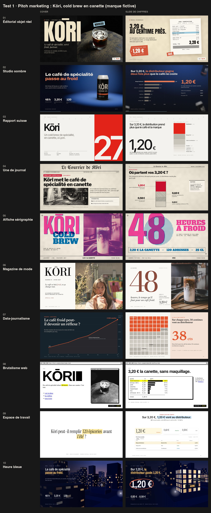
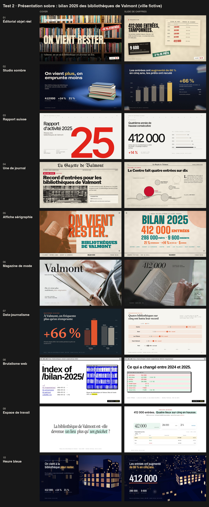

# Présentations agence

Un skill Claude qui fabrique des présentations de niveau agence, dans 8 styles tirés d'univers visuels réels, sans le look « généré par IA ».

Le principe : chaque deck emprunte les codes d'un objet qui existe vraiment (un ticket de caisse, une une de journal, une affiche sérigraphiée, un rapport annuel suisse). Le format raconte le concept avant même que le texte soit lu. C'est l'inverse d'un template, qui part d'une grille vide et la remplit.

## Les 8 styles

| Style | Univers réel | Pour |
| --- | --- | --- |
| Éditorial objet réel | Magazine + objets du sujet (ticket, menu, billet) | Pitchs de marque, lancements |
| Studio sombre | Photo de produit en studio, objet 3D en three.js | Soutenances, investisseurs, données |
| Rapport suisse | Rapports annuels suisses, style typographique international | Bilans, finance, gouvernance |
| Une de journal | Presse quotidienne, éditions spéciales | Annonces, institutions, grand public |
| Affiche sérigraphie | Affiches de concert, risographie, caractères en bois | Événements, culture, associations |
| Magazine de mode | Couvertures et éditoriaux de magazines | Mode, beauté, marques à forte image |
| Data-journalisme | Enquêtes graphiques de la presse | Études, mémoires, analyses chiffrées |
| Brutalisme web | Premiers sites web, docs techniques, terminaux | Produits tech, publics développeurs |

Chaque style a ses gabarits validés dans [`presentations-agence/gabarits/`](presentations-agence/gabarits) et sa fiche dans [`presentations-agence/references/`](presentations-agence/references) : palette avec le rôle de chaque couleur, polices Google Fonts, éléments signature, traitement des images, 12 à 16 layouts, ton, interdits et check avant de livrer.

## Ce que fait le skill

1. **Le fond d'abord** : brief, recherche sourcée, storyline lisible par les seuls titres.
2. **Les questions de style** sous forme de choix, avec deux styles recommandés et une option audacieuse.
3. **Les images** : recherche Unsplash sans contourner les protections anti-bot, téléchargement en haute définition, traitement Python propre au style (étalonnage, dégradé sous le texte, grain, trame deux encres, tramage 1 bit).
4. **Le tirage des layouts** : un script tire au sort un layout par slide (jamais deux formes identiques côte à côte, jamais le même layout deux fois, en évitant ceux des projets récents). Un modèle qui choisit seul revient toujours au même layout.
5. **Un template monté depuis 30 gabarits validés**, avec une slide « règles », rempli avec le vrai contenu.
6. **La boucle de rendu et de critique** : chaque slide rendue en PNG, une planche contact, une planche floue pour juger les masses, le test des titres seuls, la détection des slides voisines trop semblables, puis une critique notée sur les captures (sept passes, plafonds, trois rounds au plus).
7. **Le deck final**, avec le script de l'orateur dans les notes et un export HTML autonome.

## Installer

- **Claude.ai ou l'app Claude** : télécharge `presentations-agence.skill` dans les [releases](../../releases) et ouvre-le, puis clique « Save skill ».
- **Claude Code** : copie le dossier `presentations-agence/` dans `~/.claude/skills/`.

Pour être sûr que Claude l'utilise, cite-le dans ta demande : « fais-moi un deck avec le skill présentations-agence ».

## Les scripts

Dans `presentations-agence/scripts/`, utilisables seuls :

| Script | Rôle |
| --- | --- |
| `tirage.py` | Tire au sort un layout par slide selon le plan (types de contenu), avec historique entre projets |
| `nouveau_deck.py` | Monte le dossier d'un deck : CSS, polices, textures, `deck.html` assemblé depuis les gabarits |
| `images.py` | Recadrage, étalonnage par style, dégradé, grain, trame, textures papier |
| `polices.py` | Télécharge des polices Google Fonts en local et écrit `fonts.css` |
| `rendu.py` | Rend chaque slide en PNG, planche contact et planche floue, titres seuls, signale titres sur 3 lignes, débordements, polices manquantes, slides voisines trop semblables |
| `export.py` | Un seul fichier HTML hors ligne : images WebP et polices intégrées, navigation au clavier, notes |

Prérequis : Python 3.10 ou plus, `pip install pillow numpy playwright`, et Google Chrome (ou `playwright install chromium`).

## Les exemples

Le skill a été testé sur deux sujets fictifs, avec une cover et une slide de chiffres par style :

- **Kōri**, une marque fictive de cold brew en canette (pitch marketing) ;
- **le bilan 2025 des bibliothèques de Valmont**, une ville fictive (présentation sobre).

Toutes les données sont fictives. Les 8 decks de test sont dans [`examples/decks/`](examples/decks) : ouvre un fichier dans le navigateur, puis flèches pour avancer, `N` pour les notes, `F` pour le plein écran.

## Crédits photo

Photos Unsplash, sous licence Unsplash : Nathan Dumlao, Eiliv Aceron, Anton Luk, Zoshua Colah, Thomas Bormans, Priscilla Du Preez.

Le style « Studio sombre » reprend la direction artistique du deck [Are LEGO themes real universes?](https://github.com/enzontl/lego-universes).

## Licence

Code et textes du skill sous licence [MIT](LICENSE). Les photos des exemples restent sous licence Unsplash.
